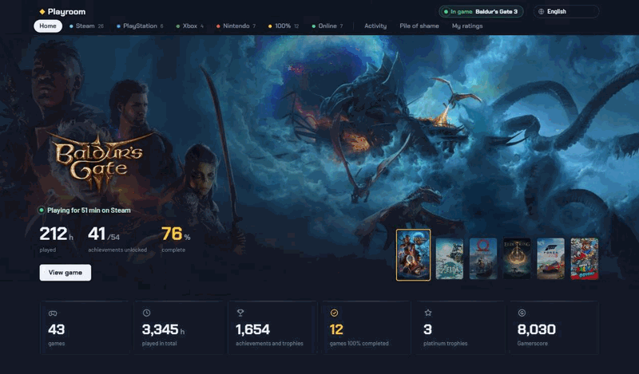
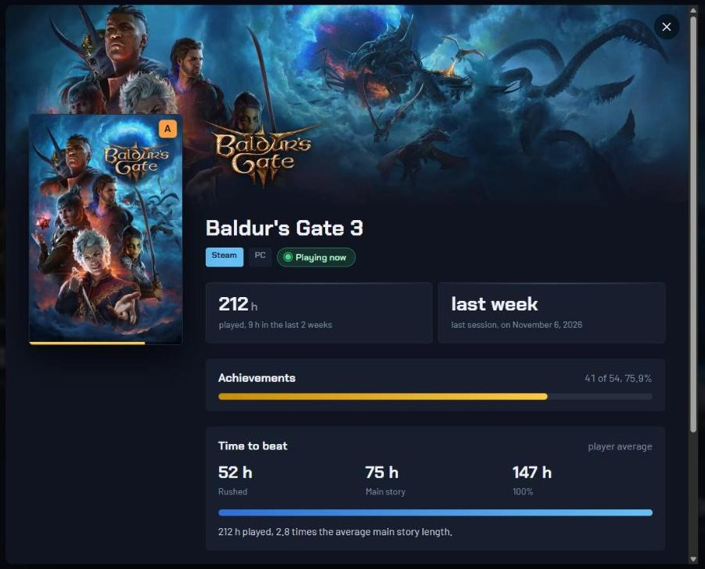
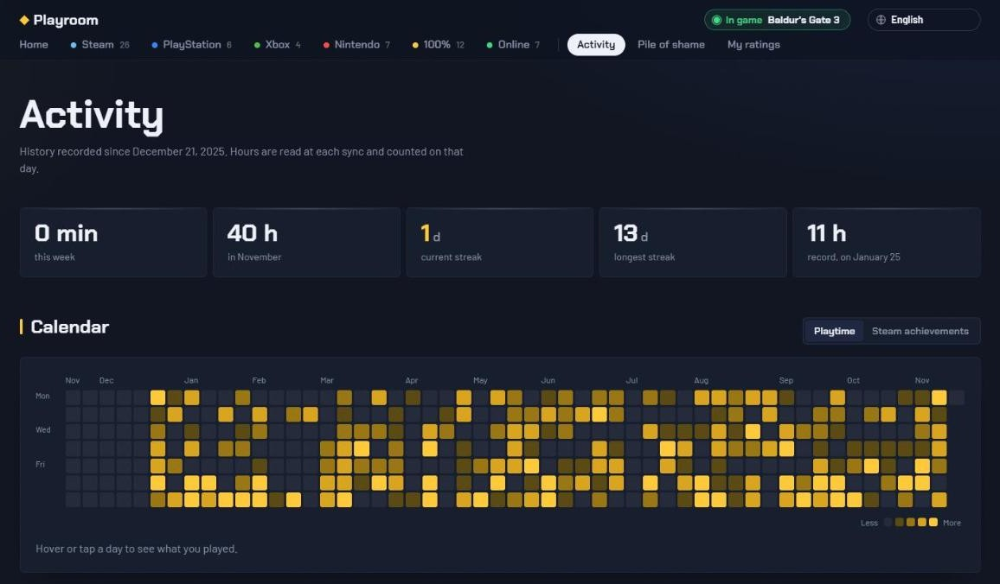
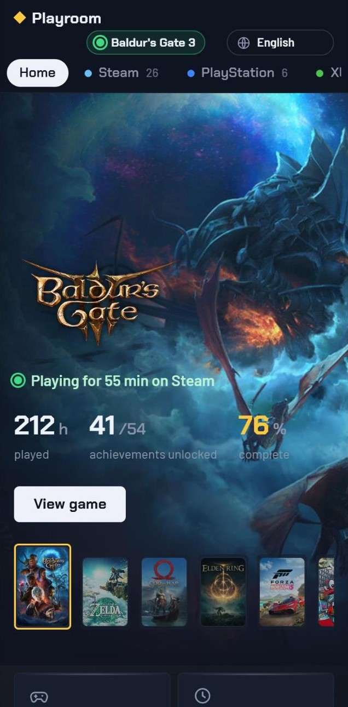
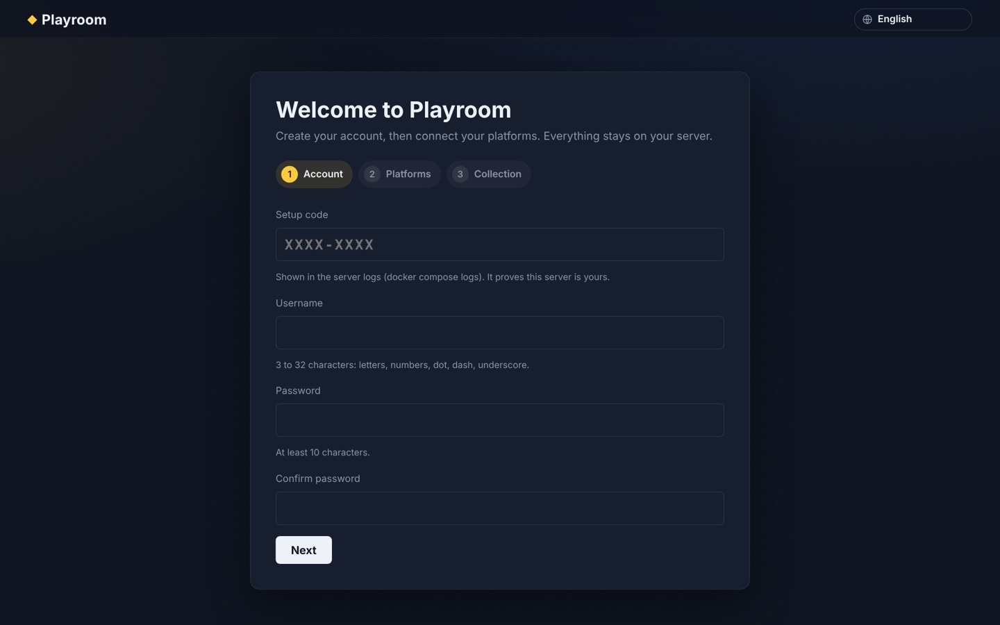

<div align="center">

# Playroom

**Your whole video game collection, on your own server.**

Steam, PlayStation, Xbox and Nintendo in one place: covers, playtime, achievements, an activity calendar and the pile of games you never started.

[](https://github.com/HexGuardSec/playroom-selfhosted/actions/workflows/ci.yml)
[](LICENSE)


[](https://github.com/HexGuardSec/playroom-selfhosted/pkgs/container/playroom-selfhosted)

**[▶ Try the live demo](https://hexguardsec.github.io/playroom-selfhosted/)** · [Français](README_fr.md)

[](https://hexguardsec.github.io/playroom-selfhosted/)

</div>

## Features

- **Every platform together**: Steam, PlayStation (PS4, PS5 and older trophy lists), Xbox, and Nintendo games you add by hand. PS4 and PS5 versions of the same game are merged automatically.
- **Real covers**: official Steam artwork, with IGDB filling in for the other platforms. A wrong cover can be fixed in two clicks.
- **Stats that matter**: hours played, achievements and trophies, 100% completions, platinum trophies and Gamerscore.
- **Activity**: GitHub-style calendar, hours per week, streaks and the games of the month.
- **Pile of shame**: games you bought and never launched, how long they take to beat, and a roulette for when you cannot decide.
- **Ratings**: S-to-D tier list, score out of 10 and short reviews.
- **Now playing**: a live badge when you are in game on Steam, PlayStation or Xbox.
- **Online games** (MMOs, competitive games) kept apart from the solo ones, detected automatically.
- **15 languages**: English, French, Spanish, German, Italian, Portuguese (Brazil), Dutch, Polish, Russian, Turkish, Arabic, Japanese, Korean, Simplified and Traditional Chinese.
- **Your account, your rules**: sign in with a password, and choose whether visitors can see your collection.
- **Light and self-contained**: Node.js only, zero npm dependencies, one Docker container.

| Game page | Activity | Phone |
|:---:|:---:|:---:|
|  |  |  |

## Quick start

With Docker and the prebuilt image (amd64 and arm64, so a Raspberry Pi works too):

```bash
mkdir playroom && cd playroom
curl -o compose.yaml https://raw.githubusercontent.com/HexGuardSec/playroom-selfhosted/main/docker-compose.example.yml
mkdir data && sudo chown 1000:1000 data     # the container runs as user 1000
docker compose up -d
docker compose logs | grep -i "setup code"
```

Prefer to build it yourself? `git clone` this repository, run `mkdir -p data && sudo chown 1000:1000 data`, then `docker compose up -d --build`.

Open `http://YOUR-SERVER:8080`. The setup page asks for:

1. **The setup code** printed in the server logs. It proves the server is yours: without it, whoever opened the site first could create the account.
2. **A username and a password** (at least 10 characters).
3. **Your API keys**. Each one is optional and comes with a link explaining how to get it. You can add or change them later in **Settings**.
4. **The site name and who can see it**: everyone (read only) or only you.

Your first sync starts right away.



### Just looking?

```bash
DEMO=true node server.js
```

This starts a read-only fake collection on `http://localhost:8080`, with nothing to configure.

### Without Docker

Requires Node.js 22 or newer, on Debian or Ubuntu:

```bash
sudo ./deploy/install.sh            # installs Node 22, copies to /opt/playroom, creates a systemd service
journalctl -u playroom | grep -i "setup code"
```

### Unraid, CasaOS and Proxmox

- **Unraid**: in the Docker tab, *Add Container*, then paste this template URL in *Template repositories* (Docker settings) or import it directly:
  `https://raw.githubusercontent.com/HexGuardSec/playroom-selfhosted/main/deploy/unraid/playroom.xml`
- **CasaOS**: *App Store* → *Custom Install* → *Import*, and paste [`deploy/casaos/docker-compose.yml`](deploy/casaos/docker-compose.yml).
- **Proxmox VE**: run the Docker compose file in an LXC container or a VM with Docker, or use `deploy/install.sh` in a Debian container.

## Getting the API keys

| Platform | Where | Notes |
|---|---|---|
| **Steam** | [steamcommunity.com/dev/apikey](https://steamcommunity.com/dev/apikey) | Any domain name works. Your profile and **Game details** must be public (Steam profile, privacy settings). The profile field accepts a SteamID64, a custom URL name or a profile link. |
| **PlayStation** | Sign in on playstation.com, then open [ca.account.sony.com/api/v1/ssocookie](https://ca.account.sony.com/api/v1/ssocookie) | Copy the `npsso` value (64 characters). It expires after about two months. |
| **Xbox** | [xbl.io](https://xbl.io) | Free OpenXBL key tied to your Microsoft account. Playtime costs one request per game, so it fills in over a few syncs. |
| **IGDB** | [dev.twitch.tv/console/apps](https://dev.twitch.tv/console/apps) | Optional but recommended: covers, time to beat and online game detection. Use `http://localhost` as the OAuth redirect. |
| **Nintendo** | No API | Add your games with **+ Add a game** on the Nintendo page. Playtime is shown on the console. |

> PlayStation has no public API. Playroom uses the same endpoints as the official mobile app, like the open source [psn-api](https://github.com/achievements-app/psn-api) project. They may change without notice.

## Configuration

Everything you need is set from the website. The optional `.env` file only holds technical settings. Copy `.env.example` to `.env` to change them:

| Variable | Default | Purpose |
|---|---|---|
| `PORT` | `8080` | Port the server listens on |
| `TZ` | system | Time zone used to split days in the calendar |
| `SYNC_INTERVAL_HOURS` | `6` | Automatic sync interval, `0` to disable |
| `PRESENCE_INTERVAL_SECONDS` | `120` | "Now playing" check interval, `0` to disable |
| `TRUST_PROXY` | `false` | Set to `true` behind a reverse proxy that handles HTTPS |
| `DEMO` | `false` | Fake read-only collection |

API keys can also be set there (`STEAM_API_KEY`, `PSN_NPSSO`…). Values saved from the website take precedence.

## Security

Playroom is meant to run on your own network, or behind HTTPS if you open it to the internet.

- **Passwords** are hashed with scrypt and never stored in clear text. Sessions use an `HttpOnly`, `SameSite=Strict` cookie, plus `Secure` over HTTPS, valid for 30 days. Changing the password signs out every other device.
- **Brute force**: 10 failed attempts within 15 minutes block the IP address.
- **CSRF**: changes must come from the site itself.
- **Headers**: strict Content Security Policy (no third-party scripts), no framing, `nosniff`, `no-referrer`.
- **API keys never leave the server**: Settings only shows their last four characters, and they are stripped from logs and error messages.
- **Container**: runs as a non-root user, with a read-only file system except `data/`, no capabilities and `no-new-privileges`.
- **Data at rest**: `data/account.json`, `data/sessions.json` and `data/settings.json` are only readable by the server user (mode 600), but they are not encrypted. Protect access to the server and to its backups.

### Exposing it to the internet

Put it behind a reverse proxy with HTTPS and set `TRUST_PROXY=true`. With Caddy:

```
playroom.example.com {
    reverse_proxy 192.168.1.10:8080
}
```

Found a vulnerability? See [SECURITY.md](SECURITY.md).

## Dashboard widget

`GET /api/widget` returns a flat summary (games, hours, achievements, completions, status) for dashboards such as Homepage, Homarr or Dashy. If your collection is private, use the address with its key, shown in **Settings**. Example for [Homepage](https://gethomepage.dev):

```yaml
- Playroom:
    icon: mdi-gamepad-variant
    href: http://playroom.lan:8080
    widget:
      type: customapi
      url: http://playroom.lan:8080/api/widget
      mappings:
        - field: games
          label: Games
        - field: hours
          label: Hours
        - field: status
          label: Status
```

## Backups and maintenance

- **Back up the `data/` folder.** It holds your account, keys, ratings, Nintendo games and history. History cannot be rebuilt.
- **Update**: `docker compose pull && docker compose up -d` (or `git pull && docker compose up -d --build` if you build it yourself).
- **Forgot your password?** Stop the server, delete `data/account.json` and `data/sessions.json`, then start it again. A new setup code appears in the logs. Your collection and keys are kept.

## How it works

```
server.js                 HTTP server, API, security, scheduled sync
src/auth.js               account, password hashing, sessions, setup code
src/settings.js           settings and API keys saved from the website
src/sync.js               platform sync, writes data/library.json
src/connectors/           steam, playstation, xbox, nintendo, igdb
src/history.js            activity history (playtime per day)
src/notes.js              ratings, picked covers, hidden games
src/presence.js           "now playing"
public/                   the website: index.html, app.js, styles.css, i18n.js, lang/
test/                     automated tests
```

Each sync compares playtime with the previous one and credits the difference to the day the game was last played, so the calendar gets more precise with more frequent syncs. Steam achievements carry their own unlock dates and fill in the past.

## Contributing

Bug reports, translations and pull requests are welcome. Start with [CONTRIBUTING.md](CONTRIBUTING.md). Before opening a pull request, run:

```bash
npm run check && npm test
```

## Roadmap

What comes next, with target dates: [ROADMAP.md](ROADMAP.md).

## Policies

- [Security policy](SECURITY.md): how to report a vulnerability privately.
- [Privacy](PRIVACY.md): what Playroom stores, and which services it contacts. No telemetry.
- [Legal notice](LEGAL.md): trademarks, third-party API terms, no piracy, no warranty.
- [Code of conduct](CODE_OF_CONDUCT.md) and [getting help](SUPPORT.md).

## Disclaimer

Playroom is an independent project, not affiliated with or endorsed by Valve, Sony Interactive Entertainment, Microsoft, Nintendo, Twitch or Playnite. Game names, covers and logos belong to their respective owners.

## AI declaration

Playroom was built with significant help from an AI assistant. [AI-DECLARATION.md](AI-DECLARATION.md) says what the AI did and what a human did.

## License

[GNU Affero General Public License v3.0](LICENSE). You may use, study, modify and share Playroom. If you run a modified version for other people, including over a network, you must publish your changes under the same license.
