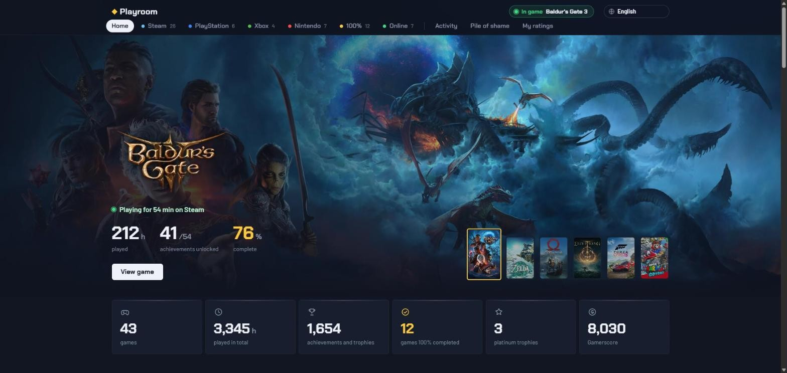
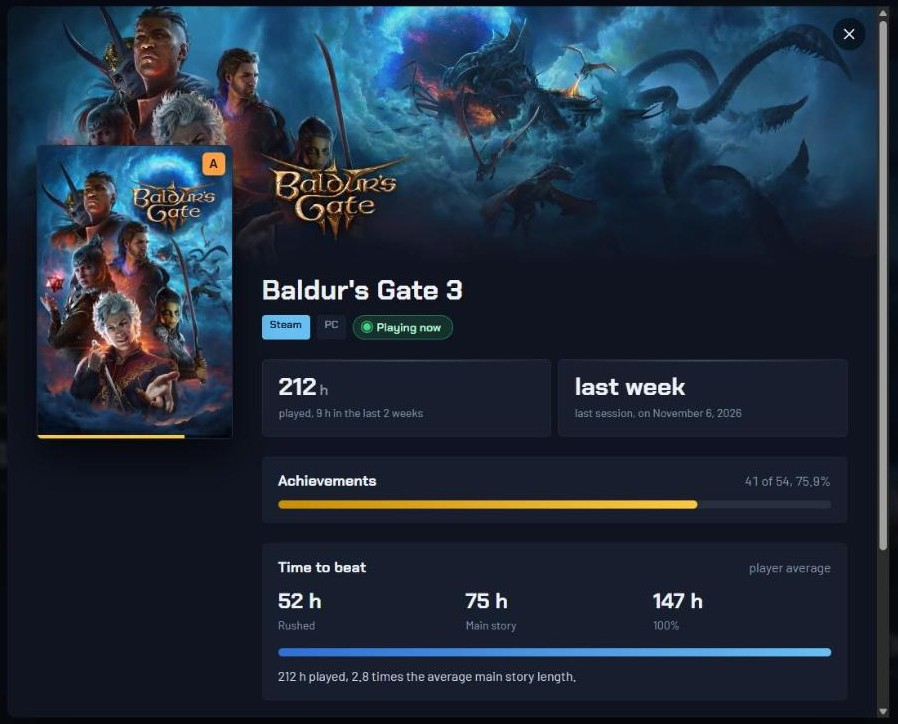
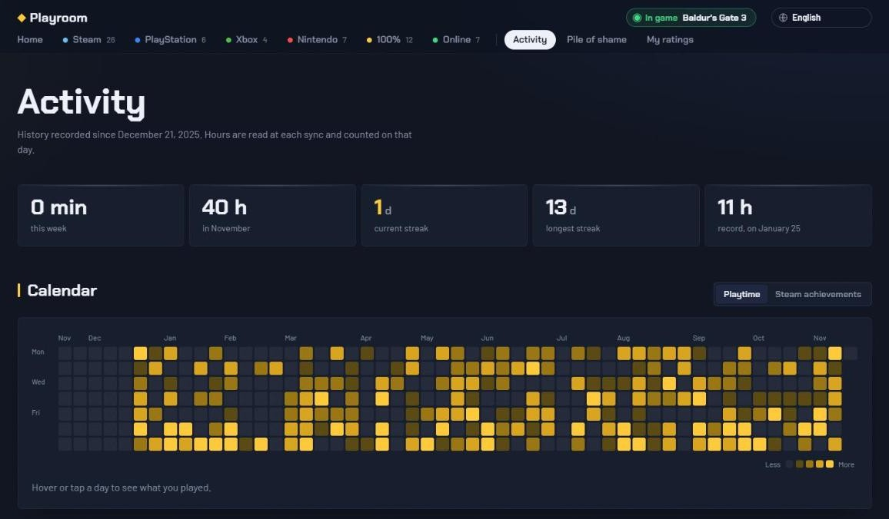
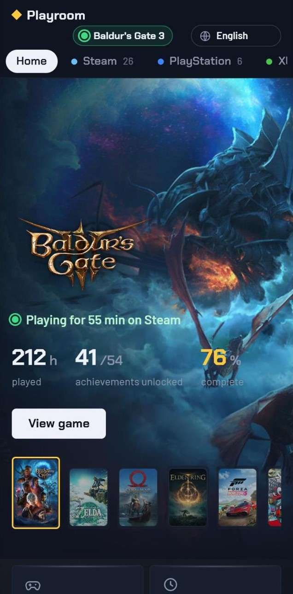

<div align="center">

# Playroom

**Toute ta collection de jeux vidéo, sur ton propre serveur.**

Steam, PlayStation, Xbox et Nintendo réunis : jaquettes, temps de jeu, succès, calendrier d'activité et la pile des jeux jamais commencés.

**[▶ Essayer la démo en ligne](https://hexguardsec.github.io/playroom-selfhosted/)** · [English](README.md)

[](https://hexguardsec.github.io/playroom-selfhosted/)

</div>

## Fonctionnalités

- **Toutes tes plateformes** : Steam, PlayStation (PS4, PS5 et anciennes listes de trophées), Xbox, et les jeux Nintendo que tu ajoutes à la main. Les versions PS4 et PS5 d'un même jeu sont fusionnées automatiquement.
- **De vraies jaquettes** : visuels officiels Steam, complétés par IGDB pour les autres plateformes. Une mauvaise jaquette se corrige en deux clics.
- **Statistiques** : heures jouées, succès et trophées, jeux à 100 %, platines et Gamerscore.
- **Activité** : calendrier façon GitHub, heures par semaine, séries et jeux du mois.
- **Pile de la honte** : les jeux achetés jamais lancés, leur durée pour les finir, et une roue pour choisir quoi lancer ce soir.
- **Notes** : tier list de S à D, note sur 10 et avis.
- **En train de jouer** : un badge en direct quand tu joues sur Steam, PlayStation ou Xbox.
- **Jeux en ligne** (MMO, compétitifs) séparés des jeux solo, détectés automatiquement.
- **15 langues**, anglais par défaut.
- **Ton compte, tes règles** : connexion par mot de passe, et tu choisis si les visiteurs peuvent voir ta collection.
- **Léger et autonome** : Node.js seulement, aucune dépendance npm, un seul conteneur Docker.

| Fiche d'un jeu | Activité | Téléphone |
|:---:|:---:|:---:|
|  |  |  |

## Démarrage rapide

Avec Docker et l'image toute prête (amd64 et arm64, donc aussi sur Raspberry Pi) :

```bash
mkdir playroom && cd playroom
curl -o compose.yaml https://raw.githubusercontent.com/HexGuardSec/playroom-selfhosted/main/docker-compose.example.yml
mkdir data && sudo chown 1000:1000 data     # le conteneur tourne avec l'utilisateur 1000
docker compose up -d
docker compose logs | grep -i "setup code"
```

Tu préfères la construire toi-même ? `git clone` du dépôt, `mkdir -p data && sudo chown 1000:1000 data`, puis `docker compose up -d --build`.

Ouvre `http://TON-SERVEUR:8080`. La page d'installation te demande :

1. **Le code d'installation** affiché dans les logs du serveur. Il prouve que le serveur est à toi : sans lui, la première personne qui ouvrirait le site pourrait créer le compte.
2. **Un identifiant et un mot de passe** (10 caractères minimum).
3. **Tes clés d'API**. Chacune est facultative et vient avec un lien qui explique comment l'obtenir. Tu peux les ajouter ou les changer plus tard dans **Paramètres**.
4. **Le nom du site et qui peut le voir** : tout le monde (lecture seule) ou toi seulement.

La première synchro démarre aussitôt.

Pour juste regarder : `DEMO=true node server.js` lance une collection fictive en lecture seule, sans rien configurer.

Sans Docker, Node.js 22 ou plus suffit. Sur Debian ou Ubuntu : `sudo ./deploy/install.sh`, puis `journalctl -u playroom | grep -i "setup code"`.

## Obtenir les clés

| Plateforme | Où | À savoir |
|---|---|---|
| **Steam** | [steamcommunity.com/dev/apikey](https://steamcommunity.com/dev/apikey) | N'importe quel nom de domaine convient. Ton profil et les **détails de jeu** doivent être publics (profil Steam, paramètres de confidentialité). |
| **PlayStation** | Connecte-toi sur playstation.com, puis ouvre [ca.account.sony.com/api/v1/ssocookie](https://ca.account.sony.com/api/v1/ssocookie) | Copie la valeur `npsso` (64 caractères). Elle expire au bout de deux mois environ. |
| **Xbox** | [xbl.io](https://xbl.io) | Clé OpenXBL gratuite liée à ton compte Microsoft. |
| **IGDB** | [dev.twitch.tv/console/apps](https://dev.twitch.tv/console/apps) | Facultatif mais recommandé : jaquettes, durée pour finir, détection des jeux en ligne. Redirection OAuth : `http://localhost`. |
| **Nintendo** | Pas d'API | Ajoute tes jeux avec **+ Ajouter un jeu** sur la page Nintendo. |

> PlayStation n'a pas d'API publique. Playroom utilise celle de l'appli mobile officielle, comme le projet open source psn-api. Elle peut changer sans préavis.

## Sécurité

- **Mots de passe** hachés avec scrypt, jamais stockés en clair. Les sessions passent par un cookie `HttpOnly`, `SameSite=Strict` (et `Secure` en HTTPS) valable 30 jours.
- **Anti force brute** : 10 échecs en 15 minutes bloquent l'adresse IP.
- **Protection CSRF et en-têtes stricts** : CSP sans script externe, anti-iframe.
- **Les clés d'API ne quittent jamais le serveur** : seuls leurs 4 derniers caractères sont affichés, et elles sont retirées des logs.
- **Conteneur durci** : il tourne sans root, en lecture seule sauf `data/`, sans aucun privilège.
- **Données au repos** : les fichiers de `data/` sont lisibles par le seul utilisateur du serveur, mais pas chiffrés. Protège l'accès au serveur et à ses sauvegardes.
- **Accès depuis Internet** : passe obligatoirement par un proxy inverse en HTTPS (Caddy, Nginx Proxy Manager, Traefik) et mets `TRUST_PROXY=true` dans `.env`.

## Entretien

- **Sauvegarde le dossier `data/`** : compte, clés, notes, jeux Nintendo et historique (l'historique ne peut pas être reconstruit).
- **Mise à jour** : `docker compose pull && docker compose up -d` (ou `git pull && docker compose up -d --build` si tu construis l'image toi-même).
- **Mot de passe oublié** : arrête le serveur, supprime `data/account.json` et `data/sessions.json`, puis redémarre. Un nouveau code d'installation apparaît dans les logs, et ta collection est conservée.

La documentation complète (configuration, widget pour tableau de bord, architecture) est dans le [README anglais](README.md).

## Contribuer

Signalements de bugs, traductions et pull requests sont les bienvenus : voir [CONTRIBUTING.md](CONTRIBUTING.md).

## Licence

[GNU AGPL v3.0](LICENSE). Tu peux utiliser, étudier, modifier et partager Playroom. Si tu fais tourner une version modifiée pour d'autres personnes, y compris en ligne, tu dois publier tes modifications sous la même licence.

Playroom est un projet indépendant, sans lien avec Valve, Sony Interactive Entertainment, Microsoft, Nintendo ou Twitch.
